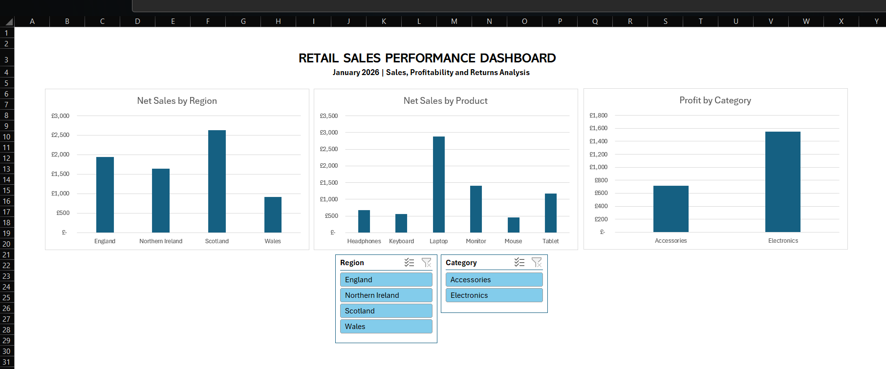

# Retail Sales and Returns Analysis Dashboard

## Project Overview

This project analyses retail sales transactions using Microsoft Excel. It explores sales performance, profitability, regional performance, product performance and customer returns.

The project uses a sample dataset containing 20 transactions from January 2026.

## Dashboard Preview

## Tools Used

- Microsoft Excel
- Excel formulas
- Excel Tables
- Pivot Tables
- Pivot Charts
- Slicers
- Data cleaning and validation

## Workbook Structure

1. Raw_Data: Original transaction dataset.
2. Cleaned_Data: Validated data with calculated sales and profit columns.
3. Pivot_Analysis: Pivot Tables used to analyse performance.
4. Dashboard: Interactive charts and slicers.

## Key Performance Indicators

| Metric | Result |
|---|---:|
| Total Sales | £7,405 |
| Discounts | £267 |
| Net Sales | £7,138 |
| Total Cost | £4,875 |
| Total Profit | £2,263 |
| Profit Margin | 31.72% |
| Returned Orders | 3 |
| Return Rate | 15% |

## Key Business Insights

- Scotland generated the highest regional net sales at £2,630.50.
- Wales generated the lowest regional net sales at £922.50.
- Laptops contributed approximately 40.28% of net sales.
- Electronics generated £1,549 in profit.
- Three out of 20 orders were marked as returned.

## Recommendations

- Monitor laptop stock and sales performance.
- Investigate sales performance in Wales.
- Review the reasons behind returned orders.
- Monitor profitability across product categories.

## Limitations

This is a small sample dataset containing 20 transactions from one month. It does not represent real company data.

Returned orders remain included in the current sales and profit calculations because refund values and returned quantities were not provided.

## Skills Demonstrated

- Data cleaning and validation
- Excel formulas
- Sales and profitability analysis
- Pivot Table reporting
- Interactive dashboard development
- Business insight generation

## Project Files

The Excel workbook contains the raw data, cleaned data, analysis and interactive dashboard.
